# art-movements-ux

<p align="center">
  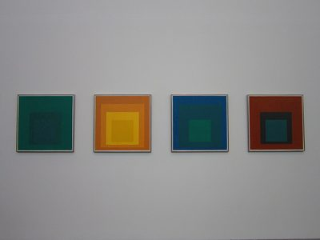
  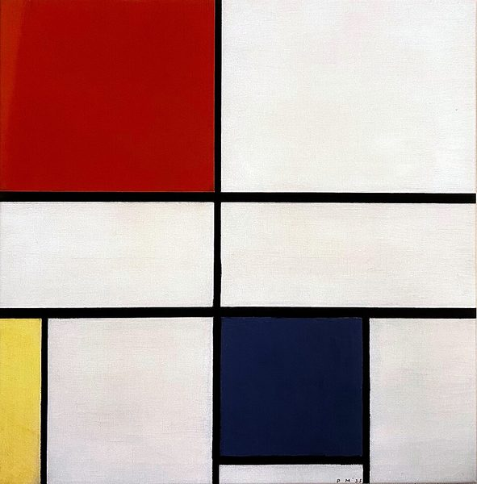
  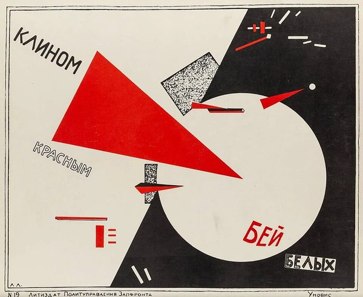
  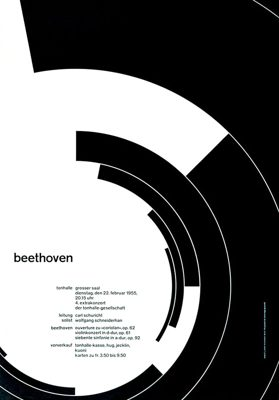
  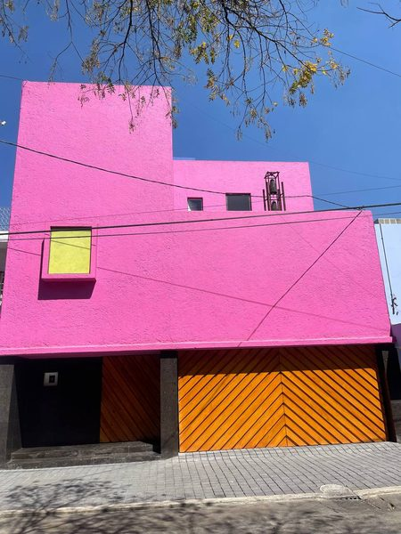
  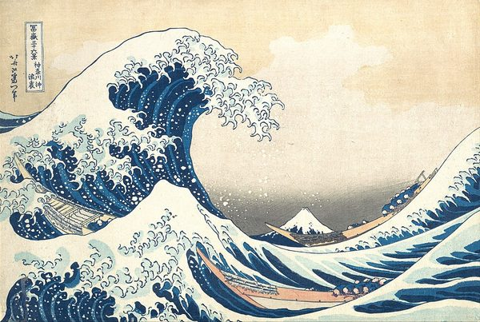
  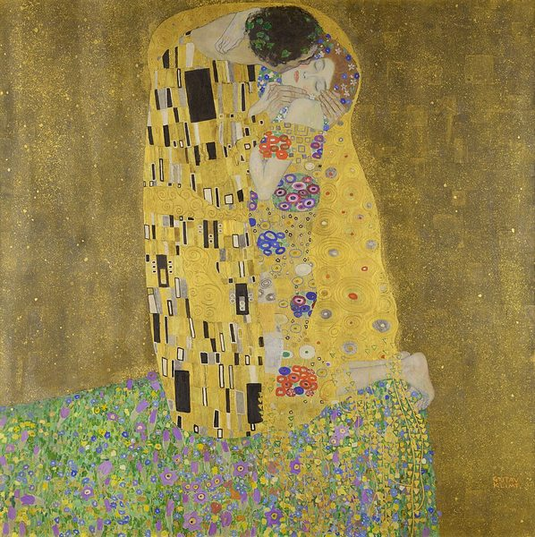
  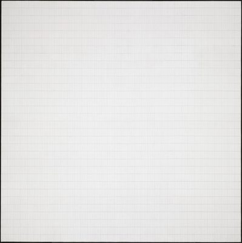
  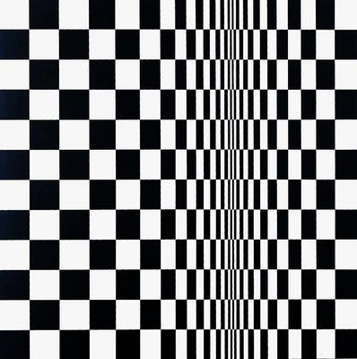
  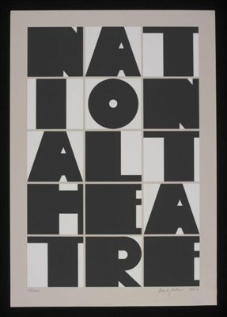
  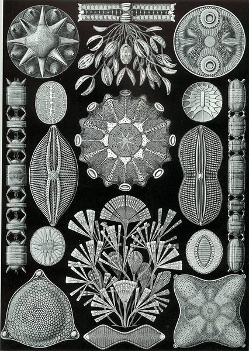
  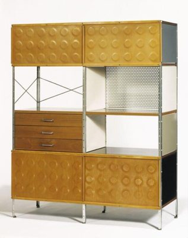
  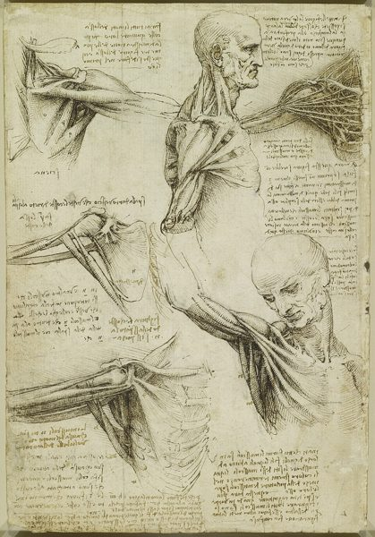
  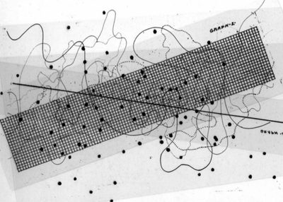
</p>

**Seventy artists, fourteen movements, one design system that looks like none of them.**

Ask a model for a UI and you get the statistical median: rounded cards on soft shadows, a centered hero, Inter at three weights, one brand blue. This skill replaces that default with a studio method. It reads your product's real design problems, pulls the artworks that already solved them, and distils those solutions into a locked brand book and UI kit. Every screen is then built from that kit, and only from it.

You never get "the Mondrian one". You get Mondrian's *reason* for a move, calibrated by his numbers, rebuilt in your brand's colours and your content's shapes.

## Why it's different

**It carries processes, not looks.** Every artist is written down as an ordered process with parameters ("freeze the geometry so that colour is the only variable"), the perceptual reason it works, when it fails, and the signature traits that must never travel together.

**It's checked against the actual works.** The entries started from museum and scholarly texts, then the key works were downloaded from open-access collections and colour-sampled (k-means in CIELAB). Hundreds of claims were corrected against the pixels. [`CHANGELOG.md`](CHANGELOG.md) records every one.

**It produces one coherent system.** Two failures are banned equally: *pastiche* (the product reads as one artist) and *patchwork* (each screen answers to a different artist). One mood board, one kit, lock rules after that.

**It has a median detector.** Rounded 12–16px cards, glassmorphism, `300ms ease-in-out` on everything, pure `#FFFFFF`: all purged unless a kit rule adopts them with a reason. The library's own habits (cream paper, one vermilion, a rotated label) are purged too.

## How it works

| Stage | What happens | Output |
|---|---|---|
| **1 · Brief** | Case, inventory, the content's own shape, 4–7 recurring design problems ranked, with one crux | Problem list |
| **2 · Mood board** | 5–9 plates, each one artwork that solved one of those problems, plus case plates (your brand, your worst real content) | Board with a thesis and one owner per layer |
| **3 · Kit** | Tokens by role with area budgets, structure, type, motion, interaction, components, voice, Do/Don't. Name, swap, elsewhere and median tests | `kit.css`, `brand-book.html`, frozen as v1.0 |
| **4 · Screens** | Built from the kit only, every decision cited by rule ID, no artist names, token lint and budget check | One HTML file per screen |
| **5 · Guardrails** | WCAG AA, reduced motion, no text on vibrating fields, 44px targets, colour never the only signal | Pass on every screen |

A single-screen request runs a **light path** through the same stages, so the next screen has a kit to obey.

### Exploration mode: ten fused triads

When nobody knows the direction yet, the skill draws **ten random triads** of artists (`scripts/triads.py`, seeded and reproducible), fuses each into one board with a cast of three roles (Skeleton owns structure, Charge owns colour, Behaviour owns motion), renders a specimen of your crux screen per triad, and lays all ten side by side. You pick one, or mix by layer (`T03.S + T07.C`). No hand-picking of artists, no re-rolling for a prettier draw: the awkward combinations are where the non-median ideas live.

## Use it

Install the folder as a skill:

```bash
cp -r art-movements-ux ~/.claude/skills/
```

Then ask for design work and say you want it art-informed, or name the method:

> Design the home screen of a budgeting app. Use art-movements-ux.

> Run an art-movements-ux exploration for our onboarding flow.

> What would Barragán do with this checkout? Single-artist study, then back to our kit.

The two helper scripts need Python 3; `measure_palette.py` also needs `pip install -r scripts/requirements.txt` (numpy, Pillow).

| Script | What it does |
|---|---|
| `scripts/triads.py` | Draws triads for Exploration mode. `--seed`, `--level artists\|movements\|mixed`, `--exclude`, `--redraw` |
| `scripts/measure_palette.py` | Clusters a screenshot or artwork into colour roles with area share, L and C, for the budget check |

## Worked example

A mobile bank, end to end: board **"Rail"** → kit → Home → Send money, with the kit's v1.1 change recorded along the way.

> *The month is one rail. What is still open sits above today, what is settled sits below, and the one thing that needs you appears on the rail ahead of you.*

Read [`references/WORKED-EXAMPLE-rail.md`](references/WORKED-EXAMPLE-rail.md), open the built files in [`references/worked-example/`](references/worked-example/), and see two triad fusions (one plain, one hard) in [`references/EXPLORATION-EXAMPLE.md`](references/EXPLORATION-EXAMPLE.md).

## The library: 14 movements, 70 artists

Each image is one work the study examines. Each name links to the full study: key works examined (and which were visually checked), process and measured relations, composition, colour, type, motion, UI translations, what the artist would reject, and sources. One-line summaries live in [`references/library.md`](references/library.md); the problem-to-process index is [`references/principles.md`](references/principles.md).

### 01 · Bauhaus

*Form follows role; shape and colour carry meaning; design as a teachable grammar.*

| Work | Artist | Process |
|:---:|---|---|
|  | **[Josef Albers](references/01-bauhaus/albers.md)**<br><sub>*Studies for Homage to the Square (installation view, Tate Modern)*, 1950s–1960s</sub> | Freeze the geometry so that colour is the only variable, then tune each colour by its neighbours until one edge dissolves and another jumps. |
| 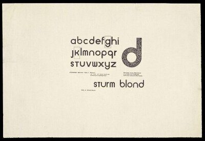 | **[Herbert Bayer](references/01-bauhaus/bayer.md)**<br><sub>*universal alphabet (proof)*, 1925</sub> | Decide the order in which things must reach the eye, then give each rank a channel of its own (size, the one colour, orientation, attachment) and delete every variant that carries no information. |
| 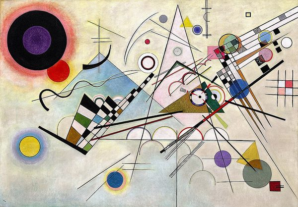 | **[Wassily Kandinsky](references/01-bauhaus/kandinsky.md)**<br><sub>*Composition VIII*, 1923</sub> | Set opposed forces against each other on a charged, mostly open plane: one heavy pole that holds the field, lighter counter-forces that pull away from it, and every role distinct in several properties at once. |
| 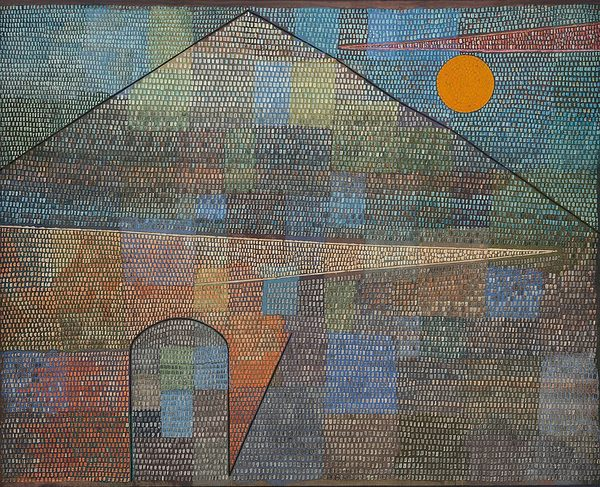 | **[Paul Klee](references/01-bauhaus/klee.md)**<br><sub>*Ad Parnassum*, 1932</sub> | Grow the surface in strata from one small module: tile the whole field, step the tone tile by tile toward a core, then let a fine lattice, a single thin line and one odd note travel over it. |
| 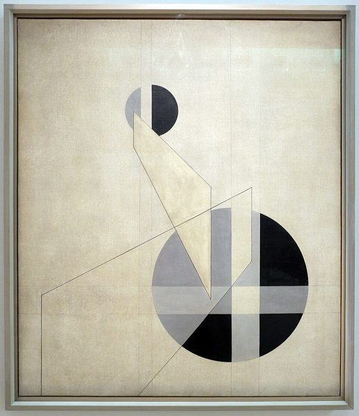 | **[László Moholy-Nagy](references/01-bauhaus/moholy-nagy.md)**<br><sub>*Composition A.XX*, 1924</sub> | Treat every surface as a filter of light with a declared state, and let overlap carry depth: wherever two planes cross, a third value must appear. |

### 02 · De Stijl

*Orthogonal planes, primaries plus non-colours, balance through inequality.*

| Work | Artist | Process |
|:---:|---|---|
|  | **[Piet Mondrian](references/02-de-stijl/mondrian.md)**<br><sub>*Composition C (No. III) with Red, Yellow and Blue*, 1935</sub> | Strike an equilibrium between unequal parts: one large quiet mass held in place by small intense counterweights at the frame. |
| 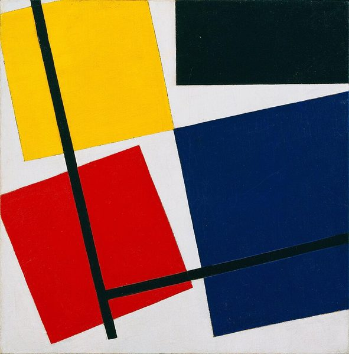 | **[Theo van Doesburg](references/02-de-stijl/van-doesburg.md)**<br><sub>*Simultaneous Counter-Composition*, 1929–30</sub> | Set two orders against each other at one angle, the order the content obeys and the order the field obeys, on a shared module, so the surface never comes to rest. |
| 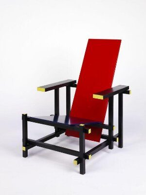 | **[Gerrit Rietveld](references/02-de-stijl/rietveld.md)**<br><sub>*Red Blue Chair*, 1918 (painted c. 1923)</sub> | Keep every part whole and readable as itself: let parts pass each other at the joints instead of merging, and spend colour only on what ends or moves. |
| 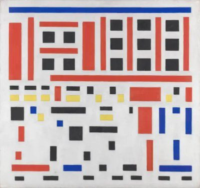 | **[Bart van der Leck](references/02-de-stijl/van-der-leck.md)**<br><sub>*Composition 1917 No. 4 (Leaving the Factory)*, 1917</sub> | Reduce a real subject to the fewest separate marks that still read as it, and let the untouched field between the marks do the joining. |
| 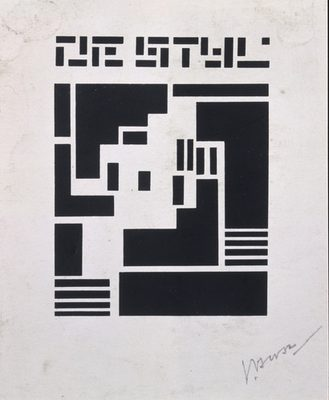 | **[Vilmos Huszár](references/02-de-stijl/huszar.md)**<br><sub>*Vignet voor De Stijl (De Stijl masthead design)*, 1917</sub> | Build word, picture and surface from one unit, and lay colour over them as a separate sheet, so any arrangement of the pieces is a finished composition. |

### 03 · Constructivism & Suprematism

*Design as a working device: diagonal force, two inks, red as action, no decoration.*

| Work | Artist | Process |
|:---:|---|---|
| 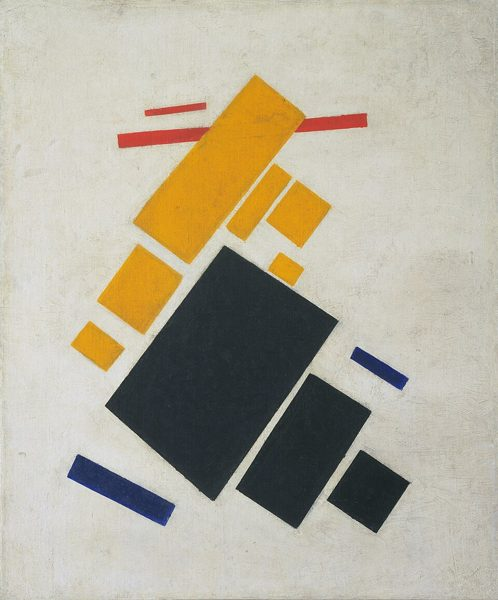 | **[Kazimir Malevich](references/03-constructivism/malevich.md)**<br><sub>*Suprematist Composition: Airplane Flying*, 1915</sub> | Make the empty field the subject: float a few unequal planes in it, clear of the frame, and rank them so that the largest is the quietest and the loudest is the thinnest. |
|  | **[El Lissitzky](references/03-constructivism/lissitzky.md)**<br><sub>*Beat the Whites with the Red Wedge*, 1919</sub> | Set one active form against one passive mass on a line of force and make everything else point along it, so that the eye, and then the hand, travels a route. |
| 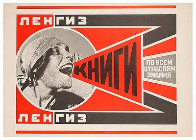 | **[Alexander Rodchenko](references/03-constructivism/rodchenko.md)**<br><sub>*Lengiz: Books in All Branches of Knowledge (poster)*, 1924</sub> | Fix one source and make the whole surface project from it: the message swells toward the reader, the ground converges back on the source, and the darkest colour holds the loudest one. |
| 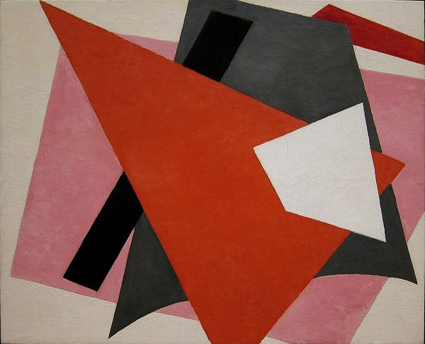 | **[Lyubov Popova](references/03-constructivism/popova.md)**<br><sub>*Painterly Architectonic*, 1917</sub> | Lay two systems over each other, soft fields beneath and hard vectors above, and tie the vectors to the frame so that the surface reads as a structure holding a load. |
| 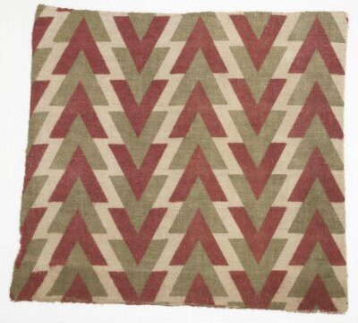 | **[Varvara Stepanova](references/03-constructivism/stepanova.md)**<br><sub>*Chevron flannel, Tsindel factory*, 1924</sub> | Set a tiny budget first (one unit, one way of building, two inks and the ground) and get every variety from repetition, offset, inversion and use. |

### 04 · Swiss / International Typographic Style

*Modular grids, flush-left grotesques, meaning through position and interval.*

| Work | Artist | Process |
|:---:|---|---|
|  | **[Josef Müller-Brockmann](references/04-swiss/muller-brockmann.md)**<br><sub>*Beethoven, Tonhalle Zürich (poster)*, 1955</sub> | Measure the field from the text line, hang everything from one off-centre axis, and let a single figure generated by a ratio carry all the scale while the words stay small and exact. |
| 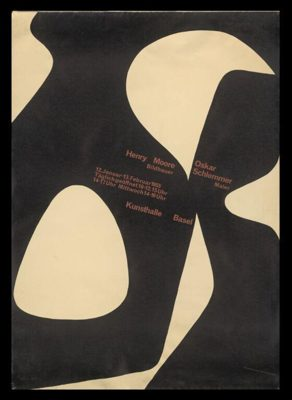 | **[Armin Hofmann](references/04-swiss/hofmann.md)**<br><sub>*Henry Moore and Oskar Schlemmer exhibition (poster)*, 1955</sub> | Oppose one hard, still sign and one soft, moving image at extreme scale, let them touch at exactly one point, and give changing information a fixed slot so the opposition never has to move. |
| 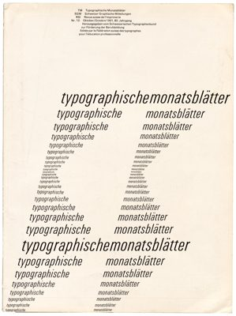 | **[Emil Ruder](references/04-swiss/ruder.md)**<br><sub>*Typographische Monatsblätter No. 10 (cover)*, 1961</sub> | Compose the unprinted area first, as the largest shape on the page; make every dark thing a grey texture of one family; and produce variety by stepping one variable at a time. |
| 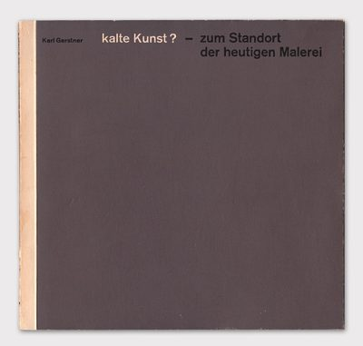 | **[Karl Gerstner](references/04-swiss/gerstner.md)**<br><sub>*kalte Kunst? (book cover)*, 1957</sub> | Do not compose: list the parameters of the problem, give each a short ordered row of values, and treat every design as one selection, so the set of selections is the work. |
| 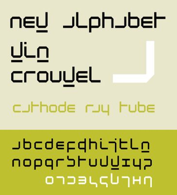 | **[Wim Crouwel](references/04-swiss/crouwel.md)**<br><sub>*New Alphabet*, 1967</sub> | Declare one square cell and build everything from whole cells, the big word included; freeze the constants of the series, so the only free choices left are one whole-region colour and what the cells spell. |

### 05 · Modernist Architecture

*The body moving through space: proportion, free planes, sequence, light and material.*

| Work | Artist | Process |
|:---:|---|---|
| 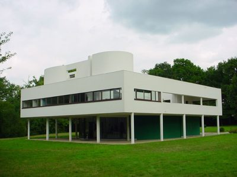 | **[Le Corbusier](references/05-modernist-arch/le-corbusier.md)**<br><sub>*Villa Savoye, Poissy*, 1928–31</sub> | Measure everything on two interlocked scales taken from one body dimension, free the partitions from the structure, and string the views on one continuous path; colour then sets each plane's depth. |
| 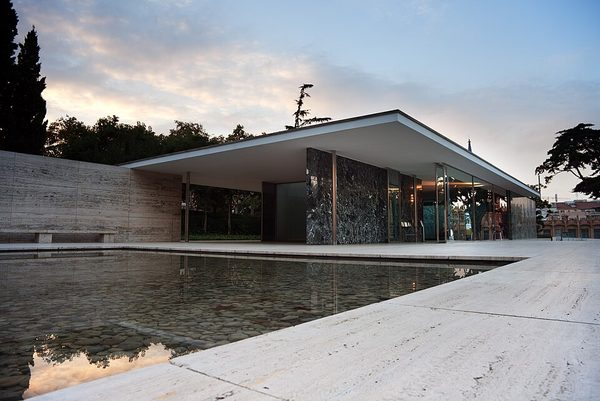 | **[Ludwig Mies van der Rohe](references/05-modernist-arch/mies.md)**<br><sub>*Barcelona Pavilion (1986 reconstruction)*, 1929</sub> | Make the system so regular that it disappears, so attention falls on the space flowing between a few free planes and on the one surface where all the richness is spent. |
| 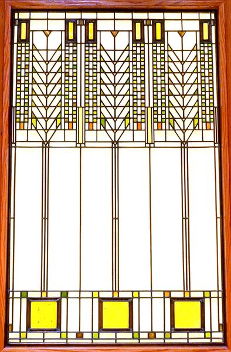 | **[Frank Lloyd Wright](references/05-modernist-arch/wright.md)**<br><sub>*Tree of Life window, Darwin D. Martin House (Princeton University Art Museum)*, 1904</sub> | Grow every part from one unit, pin the whole to one heavy core, and throw long low bands outward past their support, so the eye is led out along the horizon. |
| 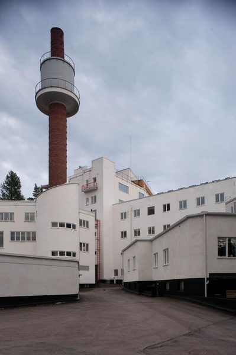 | **[Alvar Aalto](references/05-modernist-arch/aalto.md)**<br><sub>*Paimio Sanatorium*, 1929–33</sub> | Start from the body's real posture, keep a strict plain frame, and break it exactly once with a free curve where people gather; strong colour marks only what hands and feet follow. |
|  | **[Luis Barragán](references/05-modernist-arch/barragan.md)**<br><sub>*Casa Gilardi, Mexico City (street facade)*, 1975–77</sub> | Shut the world out, then ration what returns: one colour, one light and one opening per room, each felt against the room before. |

### 06 · Japanese Ma & Wabi-Sabi

*The meaningful gap, emptiness as invitation, the indirect approach, one material.*

| Work | Artist | Process |
|:---:|---|---|
|  | **[Katsushika Hokusai](references/06-japanese-ma/hokusai.md)**<br><sub>*Under the Wave off Kanagawa (The Great Wave)*, c. 1830–32</sub> | Keep one small subject constant and make each view by changing what stands in front of it: the largest, busiest form is context, and its hollow points at the subject. |
| 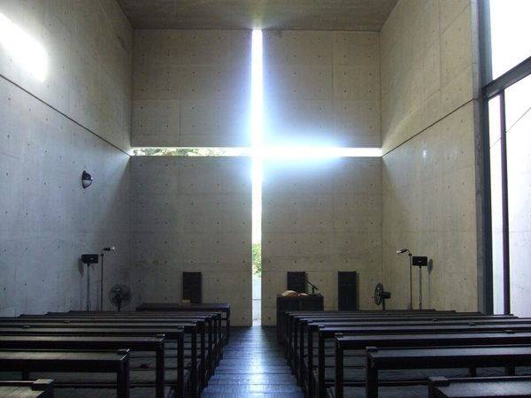 | **[Tadao Ando](references/06-japanese-ma/ando.md)**<br><sub>*Church of the Light, Ibaraki*, 1989</sub> | Close the container in one surface treatment, empty its middle, and admit the opposite end of the value scale through a single exact cut that the user must cross the emptiness to reach. |
| 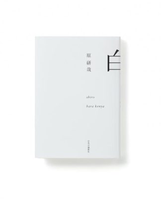 | **[Kenya Hara](references/06-japanese-ma/hara.md)**<br><sub>*White (book, Lars Müller)*, 2009</sub> | Leave the surface nearly bare, spend its only saturation on one figure, and press every piece of information back to the edges, so the viewer supplies the meaning. |
| 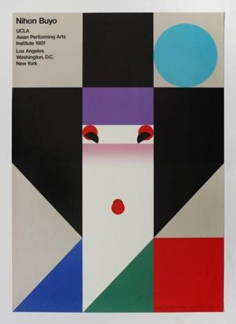 | **[Ikko Tanaka](references/06-japanese-ma/tanaka.md)**<br><sub>*Nihon Buyo (poster)*, 1981</sub> | Assemble the image from a few flat planes snapped to a coarse grid and held by one dark mass, so that every edge is two colours meeting and the eye finishes the figure. |
| 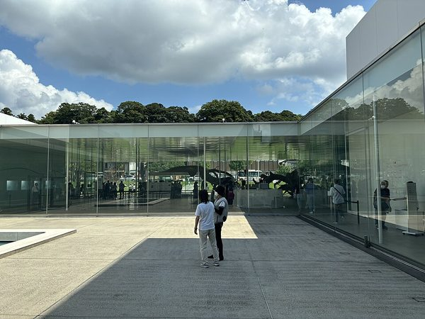 | **[Kazuyo Sejima (SANAA)](references/06-japanese-ma/sejima.md)**<br><sub>*21st Century Museum of Contemporary Art, Kanazawa*, 2004</sub> | Remove rank: pack unequal rooms into one soft envelope at a single line weight and a constant gap, and let the only emphasis be a small shift of position or what shows through. |

### 07 · Art Nouveau & Vienna Secession

*Ornament as a system and the total work of art, designed down to the spoon.*

| Work | Artist | Process |
|:---:|---|---|
| 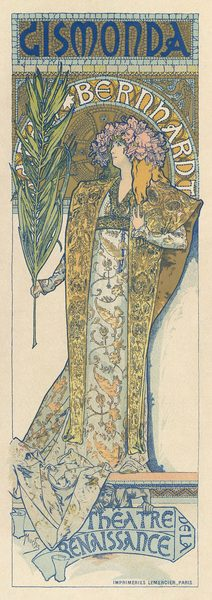 | **[Alphonse Mucha](references/07-art-nouveau-secession/mucha.md)**<br><sub>*Gismonda (Sarah Bernhardt)*, 1894–95</sub> | Build a fixed frame that does the pointing (one large quiet shape behind the focus, bands that hold the words), then change only one colour key and one emblem per variant. |
|  | **[Gustav Klimt](references/07-art-nouveau-secession/klimt.md)**<br><sub>*The Kiss*, 1908–09</sub> | Flood the surface with intensity, then make the one calm, differently rendered patch the focus; separate things by a change of texture, not by lines. |
| 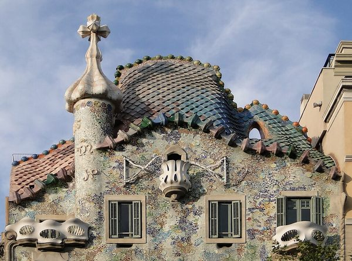 | **[Antoni Gaudí](references/07-art-nouveau-secession/gaudi.md)**<br><sub>*Casa Batlló facade*, 1904–06</sub> | Let position decide everything: a strict repeated structure whose members change girth where they carry more, coloured one step at a time along its length, with the colour broken into fragments and allowed to fall on the neutral parts. |
| 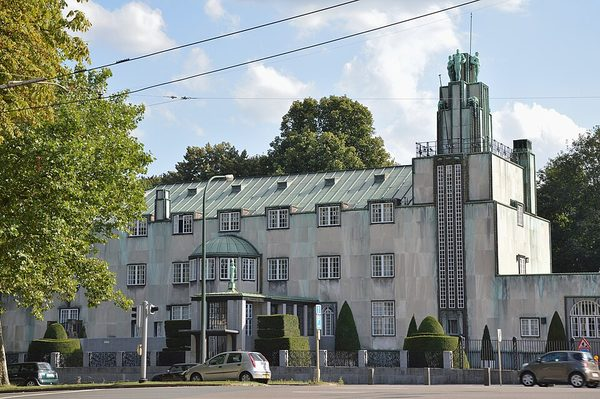 | **[Josef Hoffmann](references/07-art-nouveau-secession/hoffmann.md)**<br><sub>*Palais Stoclet, Brussels*, 1905–11</sub> | Take one square as the unit of everything, leave the planes blank, and let a thin line on every edge and a cluster of small squares at every opening do all the describing. |
| 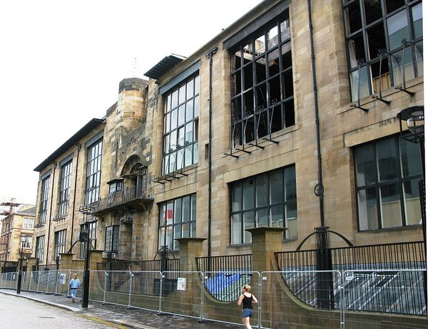 | **[Charles Rennie Mackintosh](references/07-art-nouveau-secession/mackintosh.md)**<br><sub>*Glasgow School of Art, north front*, 1897–99 / 1907–09</sub> | Raise tall plain bays in a strict repeat, spend all the ornament at one height and all the irregularity in one narrow bay. |

### 08 · Minimalism / Light & Space

*No composition, only order, interval, material and light. Perception is the medium.*

| Work | Artist | Process |
|:---:|---|---|
| 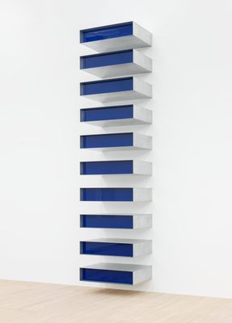 | **[Donald Judd](references/08-minimalism/judd.md)**<br><sub>*Untitled (stack)*, 1980</sub> | Abolish ranking: one stated rule sets both the units and the gaps between them, so the interval counts as much as the thing and the run is read as a whole. |
|  | **[Agnes Martin](references/08-minimalism/agnes-martin.md)**<br><sub>*Morning*, 1965</sub> | Hold every difference just above the threshold of notice: one even division and near-equal fills, so the surface is a single tone from far away and a patient structure up close. |
| 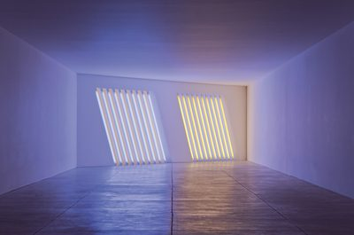 | **[Dan Flavin](references/08-minimalism/flavin.md)**<br><sub>*untitled (Marfa project)*, 1996–2000</sub> | Colour is thrown, not applied: thin sources on the edges light an empty field, and zones are made by whose light reaches them. |
| 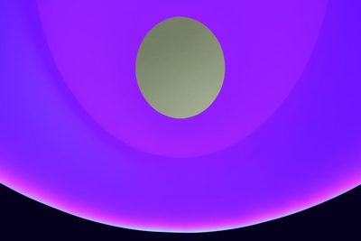 | **[James Turrell](references/08-minimalism/turrell.md)**<br><sub>*The Color Inside (Skyspace)*, 2013</sub> | Hold one field and one opening still, and change what the opening looks like only by changing its surround, more slowly than the eye can follow. |
| 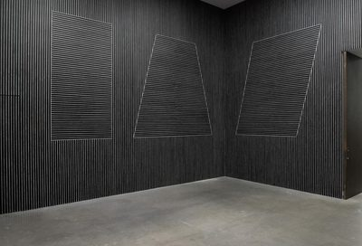 | **[Sol LeWitt](references/08-minimalism/lewitt.md)**<br><sub>*Six Geometric Figures (+ Two) (Wall Drawings)*, 1980–81</sub> | State a rule, run it to exhaustion, and show every result in an identical cell in sorted order: completeness replaces choice. |

### 09 · Op & Kinetic Art

*Colour and movement happen in the eye and in the viewer's own motion.*

| Work | Artist | Process |
|:---:|---|---|
|  | **[Bridget Riley](references/09-op-kinetic/riley.md)**<br><sub>*Movement in Squares*, 1961</sub> | Repeat one unit over the whole field, lock every property but one, and move that one along a single axis on a composed tempo: long calm, geometric build, off-centre climax, shorter release. |
| 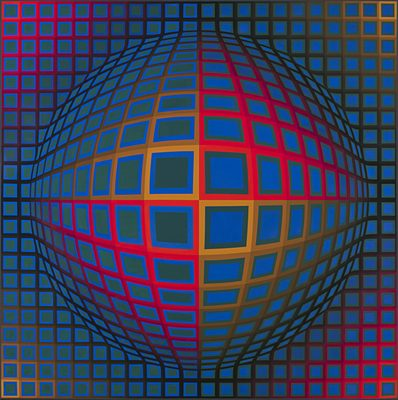 | **[Victor Vasarely](references/09-op-kinetic/vasarely.md)**<br><sub>*Vega-Nor*, 1969</sub> | Write a closed alphabet of two-layer units, fill the field with it without a gap, then bend the whole lattice with one function, so that volume and focus come from distortion and never from shading. |
| 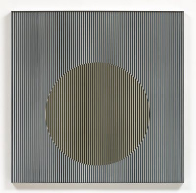 | **[Carlos Cruz-Diez](references/09-op-kinetic/cruz-diez.md)**<br><sub>*Physichromie No. 113*, 1963, reconstructed 1976</sub> | Do not paint the colour you want: set narrow bands side by side so that it arises between them, and make which colour arises depend on where the viewer is. |
| 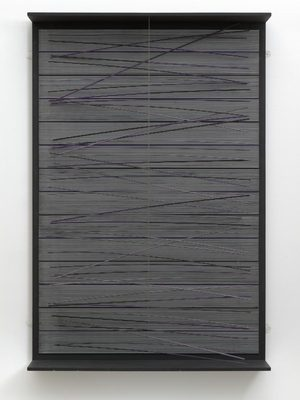 | **[Jesús Rafael Soto](references/09-op-kinetic/soto.md)**<br><sub>*Cardinal*, 1965</sub> | Hang a sparse layer of identical strokes a small gap in front of a dense one, draw no shape, and let form exist only as density, as one hue, and as the interference the viewer's own movement makes. |
| 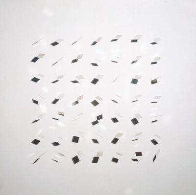 | **[Julio Le Parc](references/09-op-kinetic/le-parc.md)**<br><sub>*Continual Mobile, Continual Light*, 1963</sub> | Close the set of parts and the order of colours, state one rule, and let the rule, chance and the user's hand run every variation, with no variation and no part ranked above another. |

### 10 · Postmodern & New Wave

*Against good-taste functionalism: personality, collision, layered depth, type as voice.*

| Work | Artist | Process |
|:---:|---|---|
|  | **[Wolfgang Weingart](references/10-postmodern-newwave/weingart.md)**<br><sub>*Kunsthalle Basel, Kunstkredit 76/77 (poster)*, 1977</sub> | Keep the inherited structure in plain sight and overdrive one of its variables at a time (spacing, step, frame weight, layer) until text starts to read as image, while a plainly set copy stays within reach. |
|  | **[Ettore Sottsass (Memphis)](references/10-postmodern-newwave/sottsass.md)**<br><sub>*Carlton room divider (Memphis)*, 1981</sub> | Build the thing as a standing figure: separately treated parts joined in the open, mirrored about one axis, and balanced on a base narrower than its reach. |
|  | **[April Greiman](references/10-postmodern-newwave/greiman.md)**<br><sub>*Design Quarterly #133, "Does It Make Sense?"*, 1986</sub> | Compose in depth, not on the sheet: stack planes that each keep the grain of the tool that made them, tilt the planes, and keep the words level. |
|  | **[David Carson](references/10-postmodern-newwave/carson.md)**<br><sub>*National Theatre 50th anniversary (poster)*, 2013</sub> | On a surface meant to be looked at before it is read, let one display element carry the feeling of the piece as an image, against a quiet ground and square small text (expressive surfaces only). |
|  | **[Paula Scher](references/10-postmodern-newwave/scher.md)**<br><sub>*National Theatre 50th anniversary (poster)*, 2013</sub> | Fill the frame with words at the volume they would be spoken, and hold the crowd with one blunt structure: one flat ground, one host shape and one rule about angle. |

### 11 · Growth & Form

*Biology, engineering and computation: forms grown by a rule, found by forces, or opened once.*

| Work | Artist | Process |
|:---:|---|---|
|  | **[Ernst Haeckel](references/11-growth-form/haeckel.md)**<br><sub>*Kunstformen der Natur, Tafel 4: Diatomea*, 1899</sub> | Order by counting: build every body from one unit turned a whole number of times, double the count at each ring outward, and seat the bodies in mirrored slots round one axis. |
|  | **[Karl Blossfeldt](references/11-growth-form/blossfeldt.md)**<br><sub>*Urformen der Kunst, Plate 54: Adiantum pedatum*, 1928</sub> | Subtract until only the repeating module is left, enlarge it to fill the frame on its axis, and let the interval between repeats, never the module, carry time. |
|  | **[Frei Otto](references/11-growth-form/frei-otto.md)**<br><sub>*Roofs of the Olympic Park, Munich (with Behnisch & Partner)*, 1968-72</sub> | Place only the supports and say which edges are free; everything between them is found by relaxing one continuous surface to equilibrium, so every change is shared by the whole field. |
|  | **[Barbara Hepworth](references/11-growth-form/hepworth.md)**<br><sub>*Pelagos*, 1946</sub> | Make one closed convex whole, then open it once, off-centre; the opening, finished as the inside of the same surface, becomes the subject. |
|  | **[Nervous System](references/11-growth-form/nervous-system.md)**<br><sub>*Hyphae series*, 2011</sub> | Design the rule and not the object: a seed, an environment and one gradient, stepped locally until the space is full, and shown as a family of outcomes. |

### 12 · Cranbrook & Organic Modernism

*One school, every scale: forms moulded to body and load, one frame carried from campus to chair, variety left to the user.*

| Work | Artist | Process |
|:---:|---|---|
|  | **[Eliel Saarinen](references/12-cranbrook/eliel-saarinen.md)**<br><sub>*Saarinen House, dining room*, 1928–30</sub> | Lay one axis to a compact goal seen from the first step, pass one plain figure down through every scale and change it by one step per level, rule every surface by symmetry and nested grids, then move exactly one element off the axis; the strongest colour goes to the smallest, most recessed places. |
|  | **[Eero Saarinen](references/12-cranbrook/eero-saarinen.md)**<br><sub>*Tulip (Pedestal) armchair, Model 150*, 1955–56</sub> | Find the one element that carries the view and make it the whole form: nothing else bears, supports gather to a few narrow contacts that widen into what they hold, thickness follows load, and the only strong colour goes where the user touches. |
|  | **[Charles and Ray Eames](references/12-cranbrook/eames.md)**<br><sub>*ESU 421-C (Eames Storage Unit)*, 1949–50</sub> | Set out one plain, uncoloured frame of equal cells and a short catalogue of infill types named by job; fill each cell as its own decision, keep the parts inside separate with visible joints, place strong colour only as small cells that never touch, and leave the variety to what the user puts in. |
|  | **[Florence Knoll](references/12-cranbrook/knoll.md)**<br><sub>*Paste-up for Cowles Publications offices*, c. 1961–62</sub> | Lay every surface flat with real samples and settle the area shares before composing any view; then clear the centre, give colour to whole planes only (one extreme, one inset hue), and split a tiny accent into two or three small pieces around the open middle. |
|  | **[Harry Bertoia](references/12-cranbrook/bertoia.md)**<br><sub>*Diamond chair (model 421)*, 1952</sub> | Build the form as an open field of one thin unit with gaps as wide as the unit, and draw with crowding and thinning in place of outlines; weight goes only to a rim or root, hue only to one applied solid patch, and the viewer's movement finishes it. |

### 13 · Renaissance

*Construction as content: a stated unit and axis first, measures written into the view, notes tied to their parts.*

| Work | Artist | Process |
|:---:|---|---|
|  | **[Leonardo da Vinci](references/13-renaissance/leonardo.md)**<br><sub>*The muscles of the shoulder and arm (RCIN 919003)*, c. 1510–11</sub> | Rule the measuring scaffold first and leave it showing; give one object a dominant view, with its cut, turned and changed-state views around it at a fixed lower scale; let the notes take the shape of the gaps and tie them to the parts by shared letters; put the one colour on the subject only. |
|  | **[Piero della Francesca](references/13-renaissance/piero.md)**<br><sub>*Flagellation of Christ*, c. 1455–60</sub> | Fix an exact centre axis, one datum line and one unit before any content; stack the subject on the axis and split the field once, off-centre, with a divider that holds nothing; hang items of unequal scale from the datum and hold their key parts in one narrow band; leave a measured empty interval between groups; letter every station and tabulate it in the same view. |
|  | **[Leon Battista Alberti](references/13-renaissance/alberti.md)**<br><sub>*Palazzo Rucellai, Florence*, c. 1446–51</sub> | Fix the whole as one simple figure and divide it only by halving; stack every singular thing in one channel that lines up through all registers; fill the rest with one repeated module per level, each a whole fraction of the whole; draw that grid as a flat second-value layer over whatever lies beneath, and state it in numbers so the view can be rebuilt without the picture. |
|  | **[Albrecht Dürer](references/13-renaissance/durer.md)**<br><sub>*Constructed capitals K and L, Underweysung der Messung*, 1525</sub> | Declare one square module and take every stroke, gap and size from it; print the rule beside its result at the same height and line weight, one rule feeding a row of outcomes that differ only in where their inner divisions fall; name every division level with its line; sign and date each view in its open corner. |
|  | **[Andrea Palladio](references/13-renaissance/palladio.md)**<br><sub>*Villa Rotonda, I quattro libri dell'architettura, Book II*, 1570</sub> | Draw every size from one short list of whole-number ratios and derive the rest as means; show one object as two views stacked on one axis at one scale and width; write each measure inside the thing it measures; spend tone on openings only. |

### 14 · Process Music

*Rules left to run: one change at a time, held long enough to learn, over cycles of unequal length, with emptiness given a stated share.*

| Work | Artist | Process |
|:---:|---|---|
|  | **[Steve Reich](references/14-process-music/reich.md)**<br><sub>*Pendulum Music (handwritten text score)*, 1968</sub> | Set one short cell on a grid of 8 or 12 equal slots and lay an identical copy beside it; state one rule in a sentence and change one slot per step, holding each state long enough to learn; lock emphasis and value set, show more by filling gaps, never by size or speed; draw every state as an equal module and end where the rule began. |
|  | **[Philip Glass](references/14-process-music/glass.md)**<br><sub>*Einstein on the Beach, Knee Play 3 (manuscript fragment)*, 1975–76</sub> | Fix one pitch and a small stock of units; repeat a short figure until it is known, then change only its length, one named rule at a time, adding whole units at one end while size, weight and tint stay level; bring in a new layer only while the length is still; join blocks by a cut; write every count beside its stage as a sum. |
|  | **[Arvo Pärt](references/14-process-music/part.md)**<br><sub>*Für Alina (autograph, first page)*, 1976</sub> | Fix one home value and end every sequence on it; give each free value a companion limited to three fixed values, set by one rule; grow sequences by one unit in mirrored pairs; mark each return with one unchanging sign across an empty band; size every gap from its group; break the rule once, late; end by removing layers and leaving the last unit out. |
|  | **[Brian Eno](references/14-process-music/eno.md)**<br><sub>*Music for Airports (back-cover graphic scores)*, 1978</sub> | Set a few plain parts on cycles of near, unequal length over an exactly held frame, counted in visits or rows and not on a clock; leave at least two thirds of each cycle empty; let each event return weaker by equal steps until gone; change state only by opening, shutting or filtering a layer; print the rules and tune them, never a result. |
|  | **[John Cage](references/14-process-music/cage.md)**<br><sub>*Fontana Mix (score materials superimposed)*, 1958</sub> | Fix the frame before the content and divide it by one short series used at two scales; fill its cells by a seeded draw from a closed chart in which empty is an entry with a stated share; change the chart, never a cell; run one second layer on an unrelated interval; write starts and ends as overlapping ranges; print one scale line; join sections by cuts. |

## What's inside

```
art-movements-ux/
├── SKILL.md                   the method: stages, lock rules, guardrails, templates
├── CHANGELOG.md               every correction made after checking the real works
├── references/
│   ├── library.md             70 artist processes (opened in Stages 2–3 only)
│   ├── principles.md          UI problems → processes, calibration ranges, tensions
│   ├── 01-bauhaus/ … 14-process-music/   one full study per artist
│   ├── WORKED-EXAMPLE-rail.md
│   ├── EXPLORATION-EXAMPLE.md
│   ├── worked-example/        kit.css, brand-book.html, home.html, send.html
│   └── BRIEF.md               the research brief each study was written to
├── assets/works/             one thumbnail per artist, credits.json
└── scripts/
    ├── triads.py
    ├── measure_palette.py
    └── requirements.txt
```

## Provenance

Entries were written from museum, foundation and scholarly sources, then checked against open-access images of the key works where they could be obtained. Hex values are measured samples, kept only for strict studies and homage; a kit takes its hues from your brand or your case. Music studies were measured from recordings (pulse, cycle length, density, silence) and read from scores and spectrograms; nobody listened to them, and each study says so. Where a work could not be obtained, the entry says so.

## Image credits

Thumbnails illustrate the commentary on each artist's method. Copyrighted works are shown small, credited to their rights holders.

<details>
<summary>All 70 works, sources and licenses</summary>

| Artist | Work | License | Source |
|---|---|---|---|
| Josef Albers | [Studies for Homage to the Square (installation view, Tate Modern), 1950s–1960s](https://commons.wikimedia.org/wiki/File:Josef_Albers%27_Studies_for_Homage_to_the_Square.jpg) | © The Josef and Anni Albers Foundation / ARS, small thumbnail for commentary (photo CC BY 2.0) | Photo: Selena N. B. H., via Wikimedia Commons |
| Herbert Bayer | [universal alphabet (proof), 1925](https://collections.vam.ac.uk/item/O1348589) | © Herbert Bayer estate / VG Bild-Kunst, small thumbnail for commentary | Victoria and Albert Museum, London |
| Wassily Kandinsky | [Composition VIII, 1923](https://commons.wikimedia.org/wiki/File:37.262_ph_web-1.jpg) | Public domain | Solomon R. Guggenheim Museum, via Wikimedia Commons |
| Paul Klee | [Ad Parnassum, 1932](https://commons.wikimedia.org/wiki/File:Ad_Parnassum,_Paul_Klee_(1932,_274).jpg) | Public domain | Kunstmuseum Bern, via Wikimedia Commons |
| László Moholy-Nagy | [Composition A.XX, 1924](https://commons.wikimedia.org/wiki/File:Laszlo_moholy-nagy,_composizione_A.XX,_1924.JPG) | Public domain (artwork); photo CC BY 3.0 | Photo: Sailko, via Wikimedia Commons (Centre Pompidou) |
| Piet Mondrian | [Composition C (No. III) with Red, Yellow and Blue, 1935](https://commons.wikimedia.org/wiki/File:Composition_C_(No.III)_with_Red,_Yellow_and_Blue_-_Mondrian_(1935).jpg) | CC BY-SA 4.0 | Photo: Egrabczewski, via Wikimedia Commons (Tate) |
| Theo van Doesburg | [Simultaneous Counter-Composition, 1929–30](https://commons.wikimedia.org/wiki/File:Simultaneous_Counter-Composition_1929-30_Theo_van_Doesburg.jpg) | Public domain | Museum of Modern Art, via Wikimedia Commons |
| Gerrit Rietveld | [Red Blue Chair, 1918 (painted c. 1923)](https://collections.vam.ac.uk/item/O142927) | © Gerrit Rietveld estate / Pictoright, small thumbnail for commentary | Victoria and Albert Museum, London |
| Bart van der Leck | [Composition 1917 No. 4 (Leaving the Factory), 1917](https://www.krollermuller.nl/en/collection/bart-van-der-leck-composition-1917-no-4-leaving-the-factory-km-100-312) | © Bart van der Leck estate / Pictoright, small thumbnail for commentary | Kröller-Müller Museum, Otterlo |
| Vilmos Huszár | [Vignet voor De Stijl (De Stijl masthead design), 1917](https://www.centraalmuseum.nl/en/collection/27425-vignet-voor-de-stijl-vilmos-huszar) | © Vilmos Huszár estate, small thumbnail for commentary | Centraal Museum, Utrecht |
| Kazimir Malevich | [Suprematist Composition: Airplane Flying, 1915](https://commons.wikimedia.org/wiki/File:Suprematist_Composition_-_Airplane_Flying_(Malevich,_1915).jpg) | Public domain | Museum of Modern Art, via Wikimedia Commons |
| El Lissitzky | [Beat the Whites with the Red Wedge, 1919](https://commons.wikimedia.org/wiki/File:Beat_the_Whites_with_the_Red_Wedge.jpg) | Public domain | Wikimedia Commons |
| Alexander Rodchenko | [Lengiz: Books in All Branches of Knowledge (poster), 1924](https://en.wikipedia.org/wiki/File:1924_Poster_by_Alexander_Rodchenko,_showing_Lilya_Brik_saying_in_Russian_Books_(Please)_in_all_branches_of_knowledge.jpg) | © A. Rodchenko estate, small thumbnail for commentary | English Wikipedia file page |
| Lyubov Popova | [Painterly Architectonic, 1917](https://commons.wikimedia.org/wiki/File:NY_Moma_popova_architectonic.JPG) | Public domain | Museum of Modern Art, via Wikimedia Commons |
| Varvara Stepanova | [Chevron flannel, Tsindel factory, 1924](https://collections.vam.ac.uk/item/O1371413) | © Varvara Stepanova estate, small thumbnail for commentary | Victoria and Albert Museum, London |
| Josef Müller-Brockmann | [Beethoven, Tonhalle Zürich (poster), 1955](https://commons.wikimedia.org/wiki/File:Josef_M%C3%BCller-Brockmann._beethoven_poster(1955).jpg) | © Josef Müller-Brockmann estate, small thumbnail for commentary | Wikimedia Commons |
| Armin Hofmann | [Henry Moore and Oskar Schlemmer exhibition (poster), 1955](https://collections.vam.ac.uk/item/O121807/) | © Armin Hofmann estate, small thumbnail for commentary | V&A |
| Emil Ruder | [Typographische Monatsblätter No. 10 (cover), 1961](https://fontsinuse.com/uses/18507/typographische-monatsblaetter-1961-no-10) | © Emil Ruder estate, small thumbnail for commentary | Fonts In Use |
| Karl Gerstner | [kalte Kunst? (book cover), 1957](https://commons.wikimedia.org/wiki/File:Karl_Gerstner_Kalte_Kunst_1957.jpg) | © Karl Gerstner estate, small thumbnail for commentary | Wikimedia Commons |
| Wim Crouwel | [New Alphabet, 1967](https://commons.wikimedia.org/wiki/File:NewAlphabetSpec2.png) | © Wim Crouwel estate, small thumbnail for commentary | Wikimedia Commons |
| Le Corbusier | [Villa Savoye, Poissy, 1928–31](https://en.wikipedia.org/wiki/File:VillaSavoye.jpg) | CC BY-SA 3.0 (photo) | Wikipedia |
| Ludwig Mies van der Rohe | [Barcelona Pavilion (1986 reconstruction), 1929](https://commons.wikimedia.org/wiki/File:The_Barcelona_Pavilion,_Barcelona,_2010.jpg) | CC BY 3.0 | Ashley Pomeroy, Wikimedia Commons |
| Frank Lloyd Wright | [Tree of Life window, Darwin D. Martin House (Princeton University Art Museum), 1904](https://commons.wikimedia.org/wiki/File:Tree_of_Life_window_for_the_Darwin_D._Martin_House,_by_Frank_Lloyd_Wright,_American,_1904,_glass,_brass_-_Princeton_University_Art_Museum_-_DSC06964.jpg) | Public domain | Daderot, Wikimedia Commons |
| Alvar Aalto | [Paimio Sanatorium, 1929–33](https://commons.wikimedia.org/wiki/File:Paimio_Sanatorium.jpg) | CC BY 2.0 | Leon Liao, Wikimedia Commons |
| Luis Barragán | [Casa Gilardi, Mexico City (street facade), 1975–77](https://commons.wikimedia.org/wiki/File:Casa_Gilardi_de_Luis_Barrag%C3%A1n,_2024.jpg) | CC BY-SA 4.0 | TSolange, Wikimedia Commons |
| Katsushika Hokusai | [Under the Wave off Kanagawa (The Great Wave), c. 1830–32](https://commons.wikimedia.org/wiki/File:Tsunami_by_hokusai_19th_century.jpg) | Public domain | Metropolitan Museum of Art, via Wikimedia Commons |
| Tadao Ando | [Church of the Light, Ibaraki, 1989](https://commons.wikimedia.org/wiki/File:Ibaraki_Kasugaoka_Church_light_cross.jpg) | CC BY-SA 3.0 | Bergmann, Wikimedia Commons |
| Kenya Hara | [White (book, Lars Müller), 2009](https://a-g-i.org/user/kenyahara/) | © Kenya Hara, small thumbnail for commentary | AGI |
| Ikko Tanaka | [Nihon Buyo (poster), 1981](https://collections.vam.ac.uk/item/O1161237/nihon-buyo-poster-tanaka-ikko/) | © Ikko Tanaka estate, small thumbnail for commentary | V&A |
| Kazuyo Sejima (SANAA) | [21st Century Museum of Contemporary Art, Kanazawa, 2004](https://commons.wikimedia.org/wiki/File:Curved_glass_facade_of_the_21st_Century_Museum_of_Contemporary_Art,_Kanazawa,_September_2024.jpg) | CC BY-SA 4.0 | NevinThompson, Wikimedia Commons |
| Alphonse Mucha | [Gismonda (Sarah Bernhardt), 1894–95](https://commons.wikimedia.org/wiki/File:Alphonse_Mucha_-_Poster_for_Victorien_Sardou%27s_Gismonda_starring_Sarah_Bernhardt.jpg) | Public domain | Alphonse Mucha; restoration by Adam Cuerden, Wikimedia Commons |
| Gustav Klimt | [The Kiss, 1908–09](https://commons.wikimedia.org/wiki/File:The_Kiss_-_Gustav_Klimt_-_Google_Cultural_Institute.jpg) | Public domain | Belvedere, Vienna, via Google Arts & Culture / Wikimedia Commons |
| Antoni Gaudí | [Casa Batlló facade, 1904–06](https://commons.wikimedia.org/wiki/File:Casa_Batll%C3%B3_01.jpg) | CC BY-SA 3.0 | Bernard Gagnon, Wikimedia Commons |
| Josef Hoffmann | [Palais Stoclet, Brussels, 1905–11](https://commons.wikimedia.org/wiki/File:Palais_Stoclet,_vue_ensemble.JPG) | CC BY-SA 3.0 | Busoni, Wikimedia Commons |
| Charles Rennie Mackintosh | [Glasgow School of Art, north front, 1897–99 / 1907–09](https://commons.wikimedia.org/wiki/File:Wfm_glasgow_school_of_art.jpg) | CC BY-SA 3.0 | John a s, Wikimedia Commons |
| Donald Judd | [Untitled (stack), 1980](https://www.tate.org.uk/art/artworks/judd-untitled-t03087) | © Judd Foundation, small thumbnail for commentary | Tate |
| Agnes Martin | [Morning, 1965](https://www.tate.org.uk/art/artworks/martin-morning-t01866) | © Estate of Agnes Martin, small thumbnail for commentary | Tate |
| Dan Flavin | [untitled (Marfa project), 1996–2000](https://chinati.org/collection/dan-flavin/) | © Stephen Flavin, small thumbnail for commentary | Chinati Foundation |
| James Turrell | [The Color Inside (Skyspace), 2013](https://landmarks.utexas.edu/artwork/color-inside) | © James Turrell, small thumbnail for commentary | Landmarks, The University of Texas at Austin; photo Paul Bardagjy |
| Sol LeWitt | [Six Geometric Figures (+ Two) (Wall Drawings), 1980–81](https://www.tate.org.uk/art/artworks/lewitt-six-geometric-figures-two-wall-drawings-t03100) | © Estate of Sol LeWitt, small thumbnail for commentary | Tate |
| Bridget Riley | [Movement in Squares, 1961](https://artscouncilcollection.org.uk/artwork/movement-squares) | © Bridget Riley, small thumbnail for commentary | Arts Council Collection, Southbank Centre |
| Victor Vasarely | [Vega-Nor, 1969](https://buffaloakg.org/artworks/k196929-vega-nor) | © Estate of Victor Vasarely, small thumbnail for commentary | Buffalo AKG Art Museum |
| Carlos Cruz-Diez | [Physichromie No. 113, 1963, reconstructed 1976](https://www.tate.org.uk/art/artworks/cruz-diez-physichromie-no-113-t02094) | © Carlos Cruz-Diez estate, small thumbnail for commentary | Tate |
| Jesús Rafael Soto | [Cardinal, 1965](https://www.tate.org.uk/art/artworks/soto-cardinal-t00793) | © Estate of Jesús Rafael Soto, small thumbnail for commentary | Tate |
| Julio Le Parc | [Continual Mobile, Continual Light, 1963](https://www.tate.org.uk/art/artworks/le-parc-continual-mobile-continual-light-t00678) | © Julio Le Parc, small thumbnail for commentary | Tate |
| Wolfgang Weingart | [Kunsthalle Basel, Kunstkredit 76/77 (poster), 1977](https://collections.vam.ac.uk/item/O1155283/) | © Wolfgang Weingart estate, small thumbnail for commentary | V&A |
| Ettore Sottsass | [Carlton room divider (Memphis), 1981](https://commons.wikimedia.org/wiki/File:Ettore_sottsass_per_memphis_srl.,_libreria_carlton,_milano_1981.jpg) | CC BY 3.0 (photo) | Wikimedia Commons |
| April Greiman | [Design Quarterly #133, "Does It Make Sense?", 1986](https://commons.wikimedia.org/wiki/File:DQ133.jpg) | CC BY-SA 4.0 (photo) | Wikimedia Commons |
| David Carson | [National Theatre 50th anniversary (poster), 2013](https://collections.vam.ac.uk/item/O1364133/) | © David Carson, small thumbnail for commentary | V&A |
| Paula Scher | [National Theatre 50th anniversary (poster), 2013](https://collections.vam.ac.uk/item/O1364138/) | © Paula Scher, small thumbnail for commentary | V&A |
| Ernst Haeckel | [Kunstformen der Natur, Tafel 4: Diatomea, 1899](https://commons.wikimedia.org/wiki/File:Haeckel_Diatomea.jpg) | Public domain | Ernst Haeckel, via Wikimedia Commons |
| Karl Blossfeldt | [Urformen der Kunst, Plate 54: Adiantum pedatum, 1928](https://commons.wikimedia.org/wiki/File:Karl_Blossfeldt_Adiantum_pedatum_1928.jpg) | Public domain | Karl Blossfeldt, via Wikimedia Commons |
| Frei Otto | [Roofs of the Olympic Park, Munich (with Behnisch & Partner), 1968-72](https://commons.wikimedia.org/wiki/File:Olympic_Roof_Munich,_July_2018_-02.jpg) | CC BY-SA 4.0 | Martin Falbisoner, Wikimedia Commons |
| Barbara Hepworth | [Pelagos, 1946](https://www.tate.org.uk/art/artworks/hepworth-pelagos-t00699) | © Bowness, small thumbnail for commentary | Tate |
| Nervous System | [Hyphae series, 2011](https://n-e-r-v-o-u-s.com/pressKit/hyphaeLamp.html) | © Nervous System, small thumbnail for commentary | Nervous System |
| Eliel Saarinen | [Saarinen House, dining room, 1928–30](https://cranbrookartmuseum.org/artwork/eliel-saarinen-saarinen-house-dining-room/) | © Cranbrook Art Museum, small thumbnail for commentary | Cranbrook Art Museum |
| Eero Saarinen | [Tulip (Pedestal) armchair, Model 150, 1955–56](https://www.brooklynmuseum.org/opencollection/objects/1588) | © Eero Saarinen estate / Knoll, small thumbnail for commentary | Brooklyn Museum |
| Charles and Ray Eames | [ESU 421-C (Eames Storage Unit), 1949–50](https://collections.vam.ac.uk/item/O70986/) | © Eames Office LLC, small thumbnail for commentary | V&A |
| Florence Knoll | [Paste-up for Cowles Publications offices, c. 1961–62](https://knoll.com/story/shop/the-planning-unit) | © Knoll, Inc., small thumbnail for commentary | Knoll Archive |
| Harry Bertoia | [Diamond chair (model 421), 1952](https://commons.wikimedia.org/wiki/File:Diamond_Chair_-_Harry_Bertoia_MNAM.jpg) | © Harry Bertoia Foundation, small thumbnail for commentary | Wikimedia Commons (Centre Pompidou) |
| Leonardo da Vinci | [The muscles of the shoulder and arm (RCIN 919003), c. 1510–11](https://col.rct.uk/collection/919003/the-muscles-of-the-shoulder-and-arm-and-the-bones-of-the-neck) | Public domain | Royal Collection Trust, via Wikimedia Commons |
| Piero della Francesca | [Flagellation of Christ, c. 1455–60](https://en.wikipedia.org/wiki/Flagellation_of_Christ_(Piero_della_Francesca)) | Public domain | Galleria Nazionale delle Marche, via Web Gallery of Art |
| Leon Battista Alberti | [Palazzo Rucellai, Florence, c. 1446–51](https://commons.wikimedia.org/wiki/File:Palazzo_Rucellai_2018.jpg) | Public domain (work); photo via Wikimedia Commons | Wikimedia Commons |
| Albrecht Dürer | [Constructed capitals K and L, Underweysung der Messung, 1525](https://archive.org/details/vnderweysungderm00drer) | Public domain | Getty Research Institute, via Internet Archive |
| Andrea Palladio | [Villa Rotonda, I quattro libri dell'architettura, Book II, 1570](https://archive.org/details/HArteR07T25) | Public domain | Internet Archive |
| Steve Reich | [Pendulum Music (handwritten text score), 1968](https://exhibits.library.utoronto.ca/items/show/29575) | © Steve Reich / Universal Edition, small thumbnail for commentary | University of Toronto Libraries, online exhibits |
| Philip Glass | [Einstein on the Beach, Knee Play 3 (manuscript fragment), 1975–76](https://miskatonic.org/2012/07/08/knee-play-3) | © Philip Glass / Dunvagen Music Publishers, small thumbnail for commentary (photograph by William Denton, site text CC BY 4.0) | Miskatonic University Press (William Denton), photographed from Einstein on the Beach, ed. Vicky Alliata, 1976 |
| Arvo Pärt | [Für Alina (autograph, first page), 1976](https://www.arvopart.ee/en/arvo-part/work/477/) | © Arvo Pärt / Universal Edition; scan © Arvo Pärt Centre, small thumbnail for commentary | Arvo Pärt Centre (arvopart.ee) |
| Brian Eno | [Music for Airports (back-cover graphic scores), 1978](https://musicbrainz.org/release/38f225c8-135a-4434-a410-5049ee285c70) | © Brian Eno / E.G. Records, small thumbnail for commentary | Cover Art Archive / MusicBrainz (Japanese Polydor LP MPF 1229 scan) |
| John Cage | [Fontana Mix (score materials superimposed), 1958](https://indeterminacy.ac.uk/?p=2636) | © Henmar Press / C. F. Peters (John Cage), small thumbnail for commentary | The Future of Indeterminacy, indeterminacy.ac.uk |

</details>
